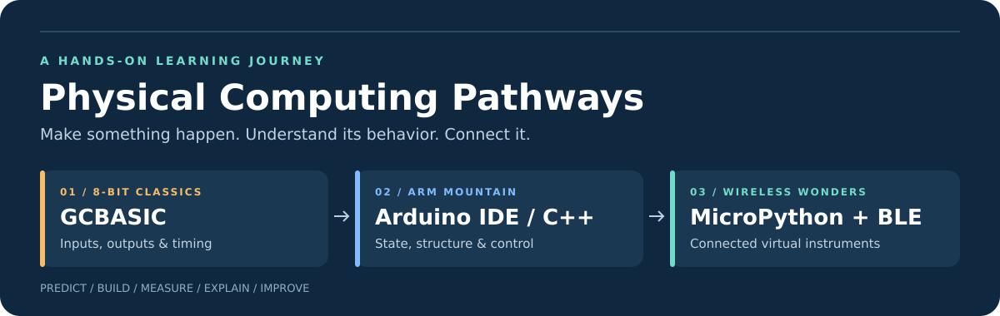

# Physical Computing Pathways

**A practical learning journey from a tiny programmed chip to a connected virtual instrument.**

[](https://github.com/RandoSY/Physical_Computing_Pathways/actions/workflows/check.yml)


**[Try the demo](#try-it-in-two-minutes)** · **[Choose a board](#hardware-and-support)** · **[Follow the curriculum](docs/CURRICULUM.md)** · **[Read the setup guide](docs/QUICKSTART.md)** · **[See validation](docs/VALIDATION.md)**

Initiated by **Rando**, this project connects three teaching themes—**8-Bit
Classics**, **ARM Mountain**, and **Wireless Wonders**—through a progression in
programming experience:

> **GCBASIC → Arduino IDE / C++ → MicroPython + BLE**
>
> Make something happen. Organize and control its behavior. Connect it to other things.

The same physical ideas return at each stage: inputs, outputs, state, timing,
measurement and communication. Learners can see what changes as a program moves
from a small BASIC experiment to structured C++ and then to an interactive
Python instrument with wireless telemetry.

> [!IMPORTANT]
> **Version 0.1.0 is an initial teaching release.** The Uno sketch compiles, the
> automated software checks pass, and the host demo runs. Physical board and
> radio testing remain outstanding. Source availability does not mean every
> listed target has been compiled, flashed or bench validated.

## Explore the project

| If you want to… | Start here |
|---|---|
| See the instrument without buying or connecting hardware | [Two-minute demo](#try-it-in-two-minutes) |
| Understand the educational progression | [The learning journey](#the-learning-journey) |
| Choose a supported starting point | [Hardware and support](#hardware-and-support) |
| Wire a board and install its software | [Quick start](docs/QUICKSTART.md) and [hardware guide](docs/HARDWARE.md) |
| Teach a sequence of labs | [Instructor curriculum](docs/CURRICULUM.md) |
| Understand or extend the firmware | [Programmer and protocol guide](docs/PROTOCOL.md) |
| Check exactly what has been tested | [Validation record](docs/VALIDATION.md) |
| See what comes next | [Roadmap](docs/ROADMAP.md) |

## The learning journey

| Stage | Teaching question | Programming experience | Hardware route |
|---|---|---|---|
| **1 · 8-Bit Classics** | What is happening inside this black box? | GCBASIC: decisions, loops, pins and waits | PIC10F322 → ATmega328P; STC/8051 comparison branch |
| **2 · ARM Mountain** | How do I make behavior explicit and portable? | Arduino IDE / C++: state machines, peripheral access and debugging | MSP430 base camp → Pico RP2040 → selected STM32 |
| **3 · Wireless Wonders** | How does a measurement become an instrument? | MicroPython + BLE: interactive experimentation and telemetry | micro:bit radio bridge → Pico W → ESP32-C3/S3 |

**The Uno is a useful language bridge.** Learners first run GCBASIC on it, then
move to Arduino C++ on the same board before changing hardware. Familiar
buttons and LEDs make the effect of the new programming approach visible.

The branches preserve architectural accuracy:

- **STC15W408AS / 8051 uses a separate SDCC C example.** It is not presented as a
  GCBASIC target. The original `STC18W408AS` part designation still needs checking
  against the actual chip marking.
- **MSP430 is a 16-bit base camp.** Its PDP-11 connection is an instructional
  comparison of programming concepts. TI's **MSPM0** is a different family
  using Arm Cortex-M0+; its firmware port is planned.
- **The supplied micro:bit experiment uses its `radio` API.** BLE begins with
  the Pico W or ESP32 instrument examples.
- **ESP32-C6/H2 are extension targets.** Working ports are not claimed in this
  release; board and firmware support must be established first.

## One experiment, increasing capability

The opening BASIC lesson is intentionally small: **hold a button to change an
LED's blink timing**. Students predict the behavior, observe it, measure it and
then inspect the program.

The C++ and MicroPython versions extend that experiment into a small instrument:

| Control or signal | What it does |
|---|---|
| **Potentiometer** | Sets the requested full blink period from **100 to 2,000 ms** |
| **Button** | Toggles run/pause after a **25 ms debounce** interval |
| **LED** | Shows the current logical output; pause forces it off |
| **USB serial** | Reports input, output and state at approximately **10 samples/second** |
| **BLE** | Publishes the same measurement fields from the MicroPython instrument |
| **Host software** | Shows a live console gauge, saves CSV and generates an offline HTML trace |

The full instrument continues operating without a connected host. The host
observes it; the firmware owns the timing and state. The BASIC and architecture
bridge examples intentionally have simpler behavior—see their lesson notes.

**Measurement matters:** a 10 Hz telemetry stream can miss short LED pulses.
Use a scope or logic analyzer to measure edge timing. ADC values are normalized
counts, not calibrated voltage measurements or a promise of 16-bit resolution.

## Try it in two minutes

You need **Git and Python 3.10 or later**. No board, Bluetooth adapter,
third-party Python package or running server is needed for this demo.

```sh
git clone https://github.com/RandoSY/Physical_Computing_Pathways.git
cd Physical_Computing_Pathways
python -m host.instrument demo --seconds 10 --csv capture.csv
python -m host.report capture.csv --output trace.html
```

Open **`trace.html`** in your browser. On Windows, use `py` in place of `python`
if that is how your Python installation is configured.

You will get:

1. A **live console gauge** showing input, requested period, LED state, run
   state and sequence number.
2. A **CSV recording** with seven explicitly defined fields.
3. An **offline HTML report** with an input trace, sequence-discontinuity count
   and the 25 most recent records.

**Demo readings are simulated.** The simulator exercises the state-machine and
host workflow; it is not evidence of a successful physical measurement.
Reusing the same output filenames replaces the earlier capture and report.

## Move from simulation to hardware

### Arduino Uno + multifunction shield

The Uno is the first target compiled in this project. The sketch assumes the
common multifunction shield described in the hardware guide.

1. Verify the shield's wiring against [HARDWARE.md](docs/HARDWARE.md).
2. Open [`PathwaysLab.ino`](firmware/arduino/PathwaysLab/PathwaysLab.ino) in
   Arduino IDE and select **Arduino Uno** with the Arduino AVR Boards package.
3. Leave `PATHWAYS_BOARD` at `1`, compile and upload.
4. Turn the potentiometer; press **S1** to pause and resume.
5. Close the IDE's Serial Monitor before using the host capture tool.

The first release uses the pot, S1 and one LED. It silences the buzzer and
blanks the numeric display. Display and tone lessons are planned extensions.

### USB serial and BLE capture

Install the optional transport dependencies in a virtual environment:

```sh
python -m venv .venv
```

| Platform | Install dependencies | Python command for subsequent steps |
|---|---|---|
| Windows PowerShell | `.\.venv\Scripts\python.exe -m pip install -r host/requirements.txt` | `.\.venv\Scripts\python.exe` |
| Linux / macOS | `.venv/bin/python -m pip install -r host/requirements.txt` | `.venv/bin/python` |

In the following commands, replace `python` with your environment's Python
command from the table. Capture USB serial:

```sh
python -m host.instrument serial --port COM5 --seconds 30 --csv capture.csv
```

Replace `COM5` with the actual device port. Linux and macOS use different port
names; examples and setup steps are in the [quick-start guide](docs/QUICKSTART.md).

For a Pico W or ESP32-C3/S3 running the supplied MicroPython firmware:

```sh
python -m host.instrument scan
python -m host.instrument ble --address YOUR_DEVICE_IDENTIFIER --seconds 30 --csv capture.csv
python -m host.report capture.csv --output trace.html
```

Select your device explicitly from the scan results. A BLE capture stops on
disconnect and preserves the CSV; scan and start a new capture to reconnect.

### MicroPython setup

Install a matching official firmware build, choose the profile in
[`board_config.py`](firmware/micropython/board_config.py), wire the external
circuit and copy the four files from [`firmware/micropython/`](firmware/micropython/)
to the board filesystem. On reset, `main.py` runs the experiment and advertises
as **`PathwaysLab`**. Give classroom devices distinct names.

The [setup guide](docs/QUICKSTART.md) covers the REPL check, file transfer,
autostart and troubleshooting. The ordinary Pico has no onboard wireless radio;
use **Pico W** for its BLE profile.

> [!CAUTION]
> Pico, STM32 and ESP32 examples use **3.3 V circuitry**. Do not connect the
> Uno shield's 5 V signals directly to them. Check the exact board pinout and
> package before wiring. Clone-board photos are not a substitute for a schematic.

## Hardware and support

**No target has been bench validated in this project yet.** The distinction
below is between compiled software, source-only examples and planned ports.

| Platform | Included software | Current evidence |
|---|---|---|
| **PIC10F322** | GCBASIC black-box lesson | Source provided; target compiler/programmer verification pending |
| **ATmega328P / Uno R3** | GCBASIC black-box lesson | Source provided; GCBASIC target compilation pending |
| **Uno R3 + multifunction shield** | Arduino C++ serial instrument | **Target compilation passed locally and in GitHub Actions** |
| **Pico / RP2040** | Arduino C++ instrument, profile 2 | Source provided; target compilation and wiring validation pending |
| **STM32** | Arduino C++ instrument, profile 3 | Example pin mapping; exact MCU, package and board configuration required |
| **STC15W408AS / 8051** | SDCC C black-box lesson | Source provided; exact part and target compilation pending |
| **MSP430G2553 LaunchPad** | TI C black-box lesson | Source provided; target compilation pending |
| **micro:bit V2** | MicroPython radio sender + USB receiver | Source provided; radio and serial testing pending |
| **Pico W** | MicroPython BLE + serial instrument | Syntax and host mocks checked; physical firmware/radio validation pending |
| **ESP32-C3 / S3** | MicroPython BLE + serial instrument | Syntax and host mocks checked; physical firmware/radio validation pending |
| **MSPM0** | Architecture transition and roadmap | Firmware port planned |
| **ESP32-C6 / H2** | Extension roadmap | No working port claimed |

See [HARDWARE.md](docs/HARDWARE.md) for exact example pins, LED polarity,
shield assumptions and electrical guidance. The PIC source uses **breadboard
wiring**; the pictured AC103011 development board requires a schematic-based
pin-map adaptation.

## What is inside

| Directory | Contents |
|---|---|
| `assets/` | Project artwork |
| `firmware/gcbasic/` | PIC10 and AVR BASIC lessons |
| `firmware/arduino/PathwaysLab/` | C++ instrument, core and board profiles |
| `firmware/micropython/` | State machine, board profiles and BLE |
| `firmware/bridges/` | STC, MSP430 and micro:bit examples |
| `host/` | Simulator, USB/BLE capture and reporting |
| `tests/` | Protocol, behavior and mock-radio checks |
| `docs/` | Teaching, setup and programmer guides |
| `.github/workflows/` | Automated software checks |

| Guide | What you will find |
|---|---|
| [QUICKSTART.md](docs/QUICKSTART.md) | Host setup, Arduino, GCBASIC, MicroPython and branch-specific instructions |
| [HARDWARE.md](docs/HARDWARE.md) | Wiring tables, support status and board-specific assumptions |
| [CURRICULUM.md](docs/CURRICULUM.md) | Teaching sequence, questions, learning checks and lab records |
| [PROTOCOL.md](docs/PROTOCOL.md) | State-machine behavior, timing, CSV fields, BLE packet and porting guidance |
| [VALIDATION.md](docs/VALIDATION.md) | Test results, compiler versions, known gaps and bench acceptance checklist |
| [ROADMAP.md](docs/ROADMAP.md) | Bench validation priorities and instrument extensions |
| [SOURCES.md](docs/SOURCES.md) | Official hardware, compiler and API references |

## Software design and telemetry

The code separates **behavior**, **hardware access** and **transport**:

- [`lab_core.h`](firmware/arduino/PathwaysLab/lab_core.h) and
  [`lab_core.py`](firmware/micropython/lab_core.py) implement the experiment's
  state machine, debounce and period mapping.
- Board profiles select pins, polarity and ADC conventions.
- Serial and BLE publish snapshots; the host validates and records them.

USB serial and saved CSV use these fields:

```text
seq,ms,input_u16,led,button,running,period_ms
0,100,32768,0,0,1,1050
```

The header is written by the host; firmware sends data lines. The BLE version
uses a **12-byte, versioned packet** with a read/notify characteristic. There is
no remote-actuator write characteristic. Sequence numbers help detect
missing, duplicate or out-of-order data and device resets.

For offsets, UUIDs, rollover behavior and porting details, see the
[protocol guide](docs/PROTOCOL.md). BLE telemetry is readable without pairing:
use these examples for non-sensitive bench signals.

## Verification and reproducibility

The initial [GitHub Actions run](https://github.com/RandoSY/Physical_Computing_Pathways/actions/runs/40111720515)
passed on the published software snapshot. The badge above reports the current
`main` workflow state.

| Check | Recorded result |
|---|---|
| Python tests | **13 passed** |
| Native C++ core checks | **Passed**: timing, debounce, pause/resume and rollover |
| Host demo → CSV → HTML report | **Passed** |
| Arduino Uno compilation | **Passed**: Arduino CLI 1.3.1, AVR core 1.8.6 |
| Uno program storage | **2,962 bytes / 32,256 bytes** |
| Uno static RAM | **210 bytes / 2,048 bytes** |
| Physical hardware and radio checks | **Pending** |

Run the software checks locally from the repository root:

```sh
python -m unittest discover -s tests -v
g++ -std=c++11 -Wall -Wextra -Werror tests/core_test.cpp -o core_test
```

Run the resulting executable (`./core_test` on Linux/macOS). Compile the Uno
sketch with Arduino IDE or:

```sh
arduino-cli core update-index
arduino-cli core install arduino:avr@1.8.6
arduino-cli compile --fqbn arduino:avr:uno --warnings all firmware/arduino/PathwaysLab
```

Tests cover malformed records, binary/text agreement, sequence wrap, debounce,
held-button behavior, tick rollover and mock BLE disconnect handling. A mock
radio test does not certify a physical radio or firmware build.

For each bench session, record the **source commit, exact board, wiring,
supply, toolchain/firmware version, expected behavior, observed behavior and
capture filename**. Keep simulated data clearly labeled.

## Next milestones

**First: validate the bench.** Compile and flash the BASIC lessons, confirm the
Uno shield, demonstrate Pico W BLE with Windows 11, and validate the selected
STC, MSP430, Pico, STM32 and ESP32 targets.

**Then: extend the instruments.** Add shield display and tone lessons, precise
edge capture, calibrated measurements, richer plotting, PIO and debugger labs,
and board-specific MSPM0/C6/H2 ports.

The [roadmap](docs/ROADMAP.md) distinguishes these future tasks from delivered
features. For improvements or test reports, use the repository's
[issue tracker](https://github.com/RandoSY/Physical_Computing_Pathways/issues)
and include the exact board, commit and reproduction steps.

## Project ownership and licensing

This curriculum project was initiated by **Rando**. The software and guides are
an evolving teaching foundation. Vendor photographs are not redistributed;
links to official references are collected in [SOURCES.md](docs/SOURCES.md).

**A license has not yet been selected.** Public repository visibility does not
itself grant an open-source license. Add an explicit license before treating
the project as licensed for redistribution or reuse.
